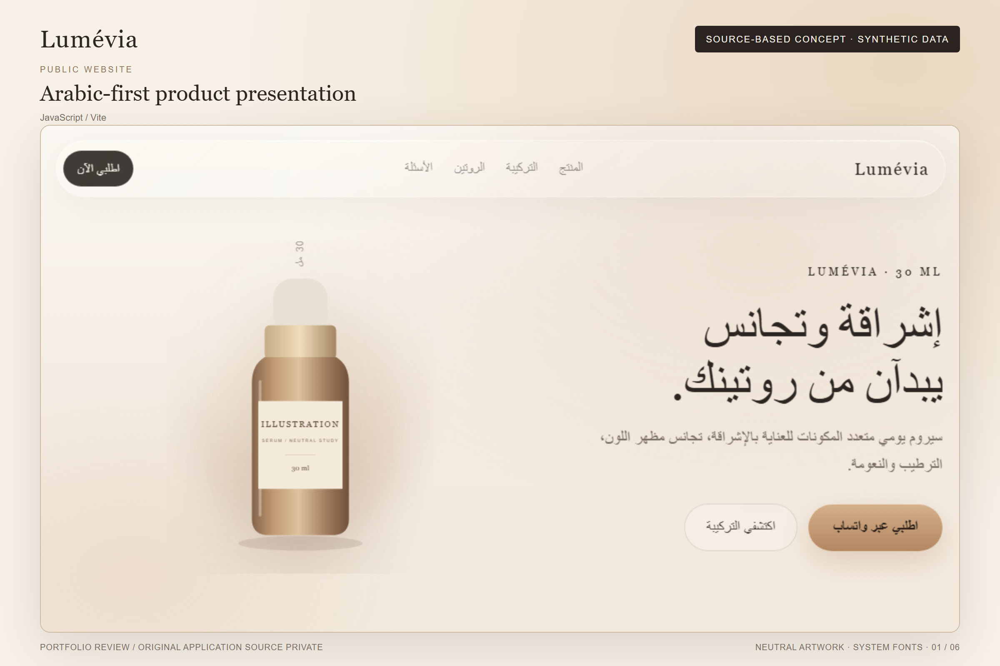
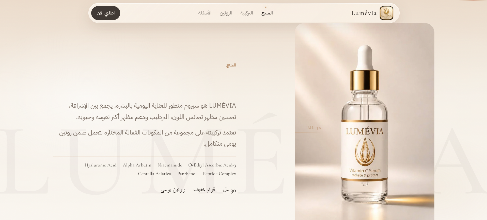
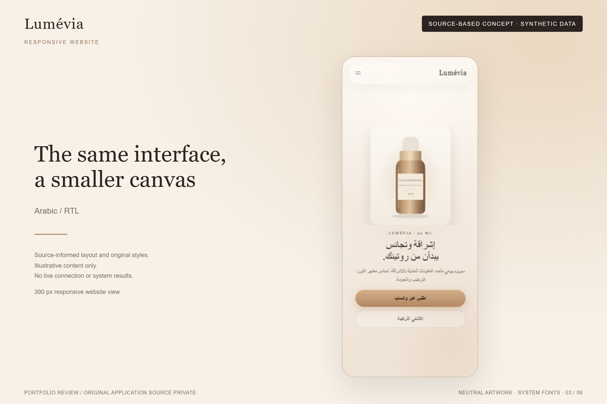
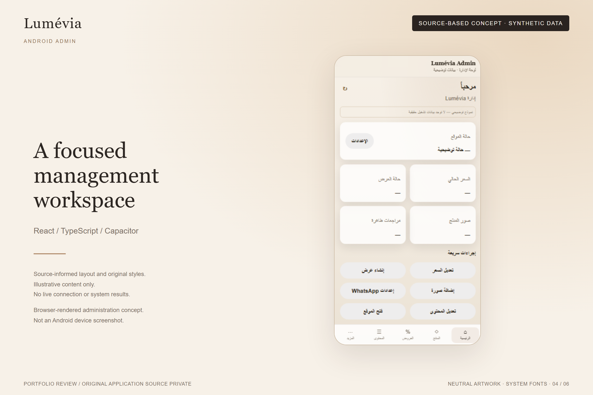
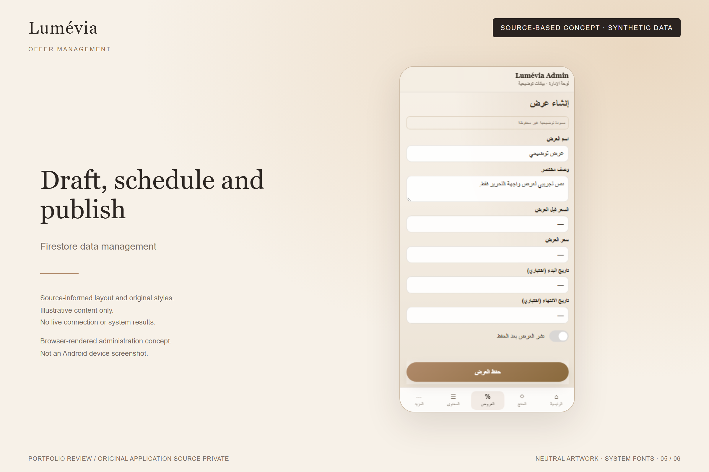
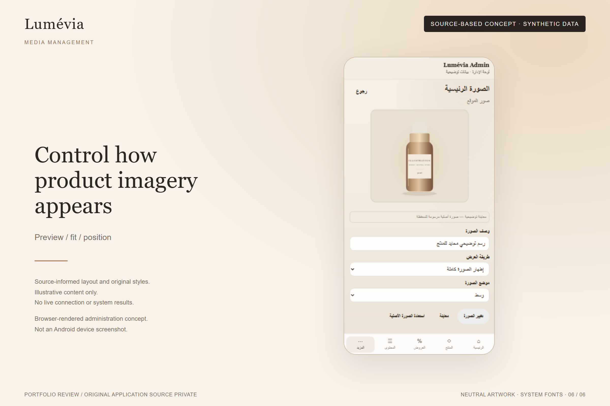

# Lumévia

An Arabic responsive product website with a separate Android administration application.

I built the public website with **JavaScript and Vite**, and the administration app with **React, TypeScript and Capacitor**. Firebase Authentication handles email/password sign-in, while Firestore stores product information, offers, website content, reviews and media metadata.

For public delivery, Cloud Functions assemble selected public fields into a snapshot and publish it to Storage. The website loads that snapshot through cached delivery with ETag support, rather than reading commerce collections directly from Firestore. Ordering hands off to WhatsApp.

## Engineering focus

- Separate public website and administrative application boundaries.
- Active-admin authorization for Firestore access and protected admin routes.
- Product, offer, content, review and media management, including scheduled offers and batched featured-offer updates.
- Public data allowlisting, content-based snapshot versioning and conditional HTTP responses.
- Android packaging with native photo selection, external browser integration and back-button handling.

Read the [architecture](docs/architecture.md) or explore the short excerpts: [snapshot versioning](excerpts/01-snapshot-versioning.md), [ETag response](excerpts/02-conditional-etag.md), [public allowlisting](excerpts/03-public-allowlisting.md), [batch updates](excerpts/04-batched-offer-updates.md) and [web/Android routing](excerpts/05-web-android-routing.md).

## Interface gallery

**The first two images are owner-approved real Lumévia brand/project images.** The owner confirmed full rights and permission to use and publish them in this portfolio showcase. The remaining four images retain their source-based concept classification and visible synthetic-data labels; they are static browser-rendered composites, not live application or Android device screenshots. Those concepts use neutral artwork and system-font substitutes. See [visual provenance](screenshots/README.md).

| Public website | Product / ingredients |
| --- | --- |
|  |  |
|  real homepage image with Lumévia branding. |  real product/ingredients image. |

| Responsive website | Android administration concept |
| --- | --- |
|  |  |
| Original responsive styles at a narrow viewport. | Management dashboard with operational values omitted. |

| Offer editor | Website image manager |
| --- | --- |
|  |  |
| An unsaved illustrative offer draft. | Image preview and display controls using neutral artwork. |

## Scope and status

This showcase documents implementation found in the private local source. Live deployment, signed Android release and Play Store distribution have not been verified. The ordering flow is a WhatsApp handoff; payment processing is not established. No performance metrics are claimed.

**Authorization limitation:** Storage media writes currently require authentication, not active-admin membership. Firestore separately restricts media attachment to active admins. Android App Check is preparation only. See the [architecture limitations](docs/architecture.md#authorization-limitations).

The original application source remains private. This showcase contains documentation, limited excerpts and curated visuals for portfolio review. The owner confirmed publication rights for the two supplied brand/project images; other material retains the rights status documented separately. See [rights](RIGHTS.md) and the [local verification record](docs/verification.md).

Developer: [MuhammedR21](https://github.com/MuhammedR21). Repository existence and visibility were not verified during local preparation.
